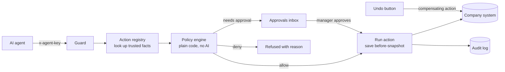

# AgentGuard

**Let AI agents work on real company systems, with a person in charge.**

AgentGuard sits between AI agents and a company's systems. Every action an agent wants to take goes through it first:

1. It is **checked** against the company's rules by plain code. AI never decides whether an action is allowed.
2. If it is risky, it **waits for a person** to approve it.
3. It is **recorded**: which agent, working for whom, which rule decided, who approved it.
4. If it was a mistake, a manager can **undo** it with one click.

> Built with MongoDB, Express, React and Node.js (TypeScript throughout). 50 automated tests, including concurrency and security cases.

**Live demo:** LIVE_DEMO_URL (free hosting: the first visit can take about a minute to wake up). Click any demo account to sign in.


---

## Why this exists

AI agents now take real actions: refunds, cancellations, account changes. In 2026 the hard part is not building an agent. It is trusting one:

- Agents sometimes take expensive actions nobody approved.
- "The AI did it" is not an audit trail.
- Teams can see that something went wrong, but cannot reverse it.

AgentGuard answers all three with one layer every agent must pass through.

## The 3-minute demo

Sign in as **Karan Shah (Manager)** and open **Try an agent**:

| Run this | What happens | What it shows |
| --- | --- | --- |
| Cancel a small booking (₹4,500) | Runs on its own | Rules let safe actions run without slowing anyone down |
| Cancel a big booking (₹7,500) | Waits in **Approvals** | A person decides risky actions |
| Split one big refund into many small ones | The ones that push today's total past ₹20,000 are **blocked** | Daily limits stop an agent from getting around a rule by splitting it up |
| Give a 40% discount | **Blocked** | Some things are never allowed |
| Email a customer | Waits for approval | Actions that cannot be undone always need a person |
| Reach into another company's booking | Not found | Each company's data is completely separate |
| Use an action that is not registered | Blocked and logged | Agents can only use actions you registered |

Then approve the big cancellation, open **Activity**, press **Undo**, and check **Company data**: the booking is back. **Audit log** shows the whole story.

| Try an agent | Activity with Undo | Full history of one action |
| --- | --- | --- |
|  |  |  |

## Architecture



```
agentguard/
  server/                      Express + TypeScript + Mongoose
    src/
      api/routes.ts            every endpoint and who may call it
      controllers/             thin HTTP layer
      services/
        actions/actionRegistry.ts   the ONLY things an agent may do, each with run + undo
        actions/guard.service.ts    request -> check -> record -> run / wait / refuse; approve; undo
        policy/policyEngine.ts      pure decision logic (unit tested, no database)
        policy/policySchemas.ts     one validation path for hand-built and AI-drafted rules
        llm/                        provider-agnostic AI (OpenAI, Claude, Ollama) for drafting only
        audit/                      append-only audit trail + CSV export
      models/                  Mongoose schemas
    tests/                     Jest + Supertest + in-memory MongoDB
  client/                      React 18 + Vite + Tailwind + React Query + Zustand
    src/screens/               approvals, activity, rules, playground, company, audit, agent keys
```

## Key decisions

| Decision | Choice | Why |
| --- | --- | --- |
| Who decides allow / deny | Plain code evaluating stored rules | Fast, predictable and testable. An attacker cannot talk a rule engine into saying yes. |
| Where AI is used | Drafting rules from a sentence, and the demo agent's planning | AI helps non-technical admins write rules, but a person confirms every rule and AI never makes the final call. |
| Whose numbers count | Facts the registry looks up from the system of record | An agent that claims "this refund is ₹1" is ignored; the params schema rejects unknown fields. |
| How undo works | Each action saves a before-snapshot and has a compensating `undo` | Same idea as the Saga pattern used in payments. Undo refuses if the record changed since, so it never overwrites newer work. |
| Irreversible actions | Marked `irreversible`, always need approval, no Undo button | Honest design: what cannot be reversed must be stopped before it happens. |
| Splitting a big action into small ones | Daily limits per agent or per company; pending requests count too | Queuing ten small requests does not get around the limit. |
| Double clicks and retries | Idempotency keys (unique index) and atomic state changes (`findOneAndUpdate` with a status filter) | Twenty Undo clicks at once undo exactly once. A retried request never acts twice. |
| Identity | Every action stores the agent **and** the person it worked for | Fixes the "the AI did it" audit problem. A manager cannot approve work requested for themselves. |
| No rule matches | A person must approve | Safe by default. |

## Run it on your Mac

You need **Node.js 20+** and **MongoDB**.

MongoDB, either:
- local: `brew tap mongodb/brew && brew install mongodb-community && brew services start mongodb-community`, or
- a free [MongoDB Atlas](https://www.mongodb.com/cloud/atlas) cluster: put its connection string in `MONGO_URI` (step 2).

```bash
# 1. Install everything (server + client)
npm install

# 2. Optional: your own settings (MongoDB address, AI provider)
cp server/env/local.env.example server/env/local.env

# 3. Create the demo companies, users and agent keys
npm run seed

# 4. Start the API (port 5050) and the app (port 5173)
npm run dev
```

Open http://localhost:5173 and pick a demo account. Every demo password is `Demo@1234`.

### Turn on AI (optional)

In `server/env/local.env`:

```bash
# Free and local, with Ollama installed:
LLM_PROVIDER=ollama
LLM_MODEL=llama3.1

# Or a hosted model:
LLM_PROVIDER=openai        # or anthropic
LLM_API_KEY=your-key
LLM_MODEL=                 # leave empty for the default
```

Restart `npm run dev`. The **Rules** page then drafts rules from a sentence, and **Try an agent** accepts plain-English instructions.

## Deploy (free)

The website and API run as one service, so there is one URL to share.

1. **Database:** create a free **M0** cluster on [MongoDB Atlas](https://www.mongodb.com/cloud/atlas). Add a database user, allow access from anywhere (`0.0.0.0/0`), and copy the connection string. Add `/agentguard` before the `?` so the data has its own database.
2. **App:** on [Render](https://render.com), choose **New > Blueprint** and pick this repository. `render.yaml` sets everything up. Paste the Atlas string into `MONGO_URI` when asked.
3. Open the Render URL. The demo companies are created on the first start (`SEED_ON_START=true`).

AI stays off on the public demo so strangers cannot run up an API bill.

## Tests

```bash
npm test
```

The first run downloads a MongoDB binary (about 100 MB) for the in-memory database. To use an existing MongoDB instead: `TEST_MONGO_URI=mongodb://127.0.0.1:27017 npm test`.

What is covered (50 tests):

- **Policy engine (pure):** every operator, the strictest rule wins, the safe default, daily limits, failing closed when an amount cannot be measured, irreversible actions, wildcard and disabled rules.
- **Rule validation:** unknown actions, invented fields, wrong value types.
- **End to end over HTTP:** auto-run, approval, the split attack, pending requests counting towards limits, cross-company isolation, unregistered actions, an agent sending its own "amount", role checks, separation of duties, idempotent retries, **20 simultaneous Undo clicks undo once**, refusing a stale undo, permanent actions, audit order, CSV formula-injection protection, AI drafting being optional.

## Connect your own agent

Any agent, in any language, calls one endpoint. Create a key on the **Agent keys** page (admins), then:

```bash
curl -X POST http://localhost:5050/api/agent/actions \
  -H "content-type: application/json" \
  -H "x-agent-key: agk_..." \
  -d '{
    "action": "booking.cancel",
    "params": { "bookingCode": "BK-1003" },
    "reason": "Customer asked in chat",
    "onBehalfOf": "Ravi (support team)",
    "idempotencyKey": "chat-4821-cancel-1"
  }'
```

Responses: `200` with `status: "done"` or `"denied"` (and the reasons), or `202` with `status: "pending_approval"`. Check later with `GET /api/agent/actions/:id`. `GET /api/agent/catalog` lists the allowed actions.

## Security notes

- Agent keys are random, shown once, and stored only as SHA-256 hashes.
- Passwords use bcrypt; the login error never reveals whether an email exists.
- Every query is scoped to the caller's workspace (company).
- Helmet headers, CORS allow-list, JSON body limit, rate limits on login and the agent API.
- Logs contain ids and structure only, never names, emails, params or request bodies.
- AI output is validated by the same schema as hand-built rules, and user text is passed to the model as data.

## Known limitations (and what I would do next)

- **Daily limits can race.** Two requests at the same instant can both pass the check. Next step: a per-workspace counter updated atomically with `$inc`, or a short lock.
- **A crash mid-action** can leave a record in "executing". Next step: a recovery job that checks the system of record and marks it done or failed.
- **Approvals do not expire.** Next step: an expiry time per rule and a reminder.
- **The demo company system lives in the same database.** In real use the registry's `run` and `undo` would call the customer's own APIs.
- **Reset demo data** clears that company's audit log too. It only exists in demo mode (`DEMO_MODE=false` turns it off).

## Built with AI, verified by me

Claude was my coding assistant. The safety design is mine to explain and defend, and behaviour is verified by the test suite, including mutation checks: breaking the code on purpose to confirm the tests catch it.

## License

MIT
