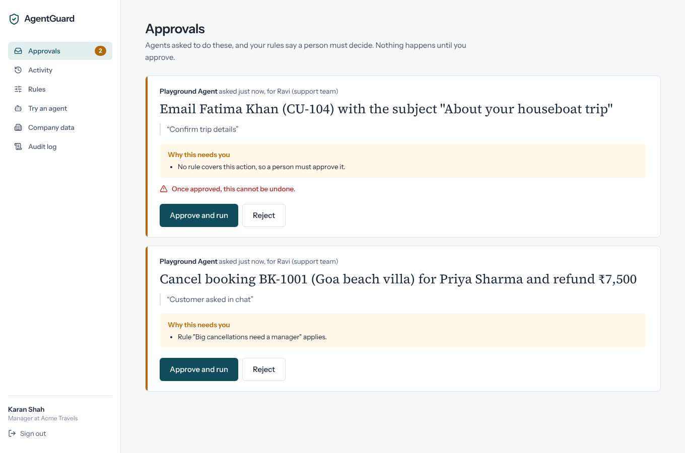
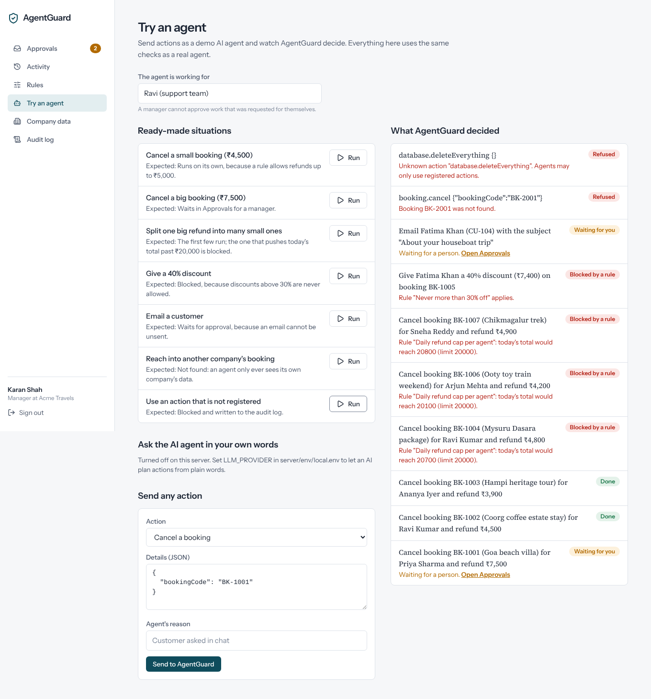
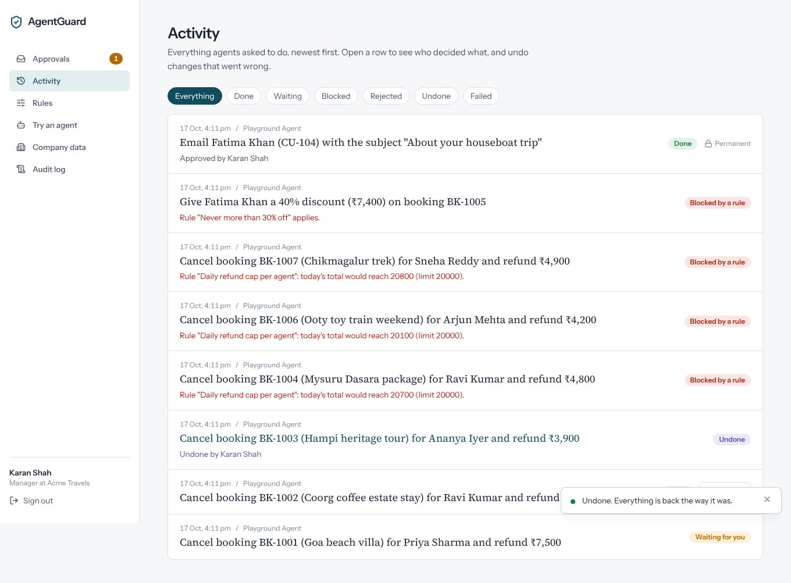
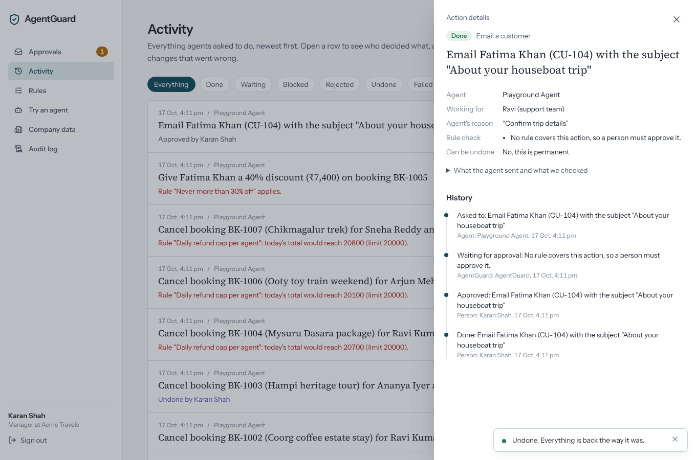
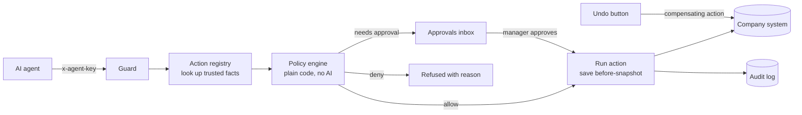

# AgentGuard

**Let AI agents work on real company systems, with a person in charge.**

AgentGuard sits between AI agents and a company's systems. Every action an agent wants to take goes through it first:

1. It is **checked** against the company's rules by plain code. AI never decides whether an action is allowed.
2. If it is risky, it **waits for a person** to approve it.
3. It is **recorded**: which agent, working for whom, which rule decided, who approved it.
4. If it was a mistake, a manager can **undo** it with one click.

> Built with MongoDB, Express, React and Node.js (TypeScript throughout). 191 automated tests, including concurrency and security cases.

**Live demo:** [agentguard.sritaraksolutions.in](https://agentguard.sritaraksolutions.in) (free hosting: the first visit can take about a minute to wake up). Click any demo account to sign in.



---

## Why this exists

AI agents now take real actions: refunds, cancellations, account changes. In 2026 the hard part is not building an agent. It is trusting one:

- Agents sometimes take expensive actions nobody approved.
- "The AI did it" is not an audit trail.
- Teams can see that something went wrong, but cannot reverse it.

AgentGuard answers all three with one layer every agent must pass through.

## The 3-minute demo

Sign in as **Karan Shah (Manager)** and open **Try an agent**:

| Run this | What happens | What it shows |
| --- | --- | --- |
| Cancel a small booking (₹4,500) | Runs on its own | Rules let safe actions run without slowing anyone down |
| Cancel a big booking (₹7,500) | Waits in **Approvals** | A person decides risky actions |
| Split one big refund into many small ones | The ones that push today's total past ₹20,000 are **blocked** | Daily limits stop an agent from getting around a rule by splitting it up |
| Give a 40% discount | **Blocked** | Some things are never allowed |
| Email a customer | Waits for approval | Actions that cannot be undone always need a person |
| Reach into another company's booking | Not found | Each company's data is completely separate |
| Use an action that is not registered | Blocked and logged | Agents can only use actions you registered |

Then approve the big cancellation, open **Activity**, press **Undo**, and check **Company data**: the booking is back. **Audit log** shows the whole story.

| Try an agent | Activity with Undo | Full history of one action |
| --- | --- | --- |
|  |  |  |

## Architecture



```
agentguard/
  server/                      Express + TypeScript + Mongoose
    src/
      api/routes.ts            every endpoint and who may call it
      controllers/             thin HTTP layer
      services/
        actions/actionRegistry.ts   the ONLY things an agent may do, each with run + undo
        actions/guard.service.ts    request -> check -> record -> run / wait / refuse; approve; undo
        policy/policyEngine.ts      pure decision logic (unit tested, no database)
        policy/policySchemas.ts     one validation path for hand-built and AI-drafted rules
        llm/                        provider-agnostic AI (OpenAI, Claude, Ollama) for drafting only
        policy/dailyLimit.service.ts atomic daily-limit counters (reserve / give back)
        approvals/                  approvals that expire (sweep + the admin setting)
        actions/recovery.service.ts settles actions a crash left half-done
        audit/                      append-only, hash-chained audit trail + verify + CSV export
      loaders/maintenance.ts   background jobs (recovery + expiry), safe on several servers
      models/                  Mongoose schemas
    tests/                     Jest + Supertest + in-memory MongoDB
  client/                      React 18 + Vite + Tailwind + React Query + Zustand
    src/screens/               approvals, activity, rules, playground, company, audit, agent keys
```

## Key decisions

| Decision | Choice | Why |
| --- | --- | --- |
| Who decides allow / deny | Plain code evaluating stored rules | Fast, predictable and testable. An attacker cannot talk a rule engine into saying yes. |
| Where AI is used | Drafting rules from a sentence, and the demo agent's planning | AI helps non-technical admins write rules, but a person confirms every rule and AI never makes the final call. |
| Whose numbers count | Facts the registry looks up from the system of record | An agent that claims "this refund is ₹1" is ignored; the params schema rejects unknown fields. |
| How undo works | Each action saves a before-snapshot and has a compensating `undo` | Same idea as the Saga pattern used in payments. Undo refuses if the record changed since, so it never overwrites newer work. |
| Irreversible actions | Marked `irreversible`, always need approval, no Undo button | Honest design: what cannot be reversed must be stopped before it happens. |
| Splitting a big action into small ones | Daily limits per agent or per company; pending requests count too; room is reserved atomically | Queuing ten small requests, or sending them all at the same instant, does not get around the limit. |
| Double clicks and retries | Idempotency keys (unique index) and atomic state changes (`findOneAndUpdate` with a status filter) | Twenty Undo clicks at once undo exactly once. A retried request never acts twice. |
| Identity | Every action stores the agent **and** the person it worked for | Fixes the "the AI did it" audit problem. A manager cannot approve work requested for themselves. |
| No rule matches | A person must approve | Safe by default. |

## Run it on your Mac

You need **Node.js 20+** and **MongoDB**.

MongoDB, either:
- local: `brew tap mongodb/brew && brew install mongodb-community && brew services start mongodb-community`, or
- a free [MongoDB Atlas](https://www.mongodb.com/cloud/atlas) cluster: put its connection string in `MONGO_URI` (step 2).

```bash
# 1. Install everything (server + client)
npm install

# 2. Optional: your own settings (MongoDB address, AI provider)
cp server/env/local.env.example server/env/local.env

# 3. Create the demo companies, users and agent keys
npm run seed

# 4. Start the API (port 5050) and the app (port 5173)
npm run dev
```

Open http://localhost:5173 and pick a demo account. Every demo password is `Demo@1234`.

### Turn on AI (optional)

In `server/env/local.env`:

```bash
# Free and local, with Ollama installed:
LLM_PROVIDER=ollama
LLM_MODEL=llama3.1

# Or a hosted model:
LLM_PROVIDER=openai        # or anthropic
LLM_API_KEY=your-key
LLM_MODEL=                 # leave empty for the default
```

Restart `npm run dev`. The **Rules** page then drafts rules from a sentence, and **Try an agent** accepts plain-English instructions.

## Deploy (free)

The website and API run as one service, so there is one URL to share.

1. **Database:** create a free **M0** cluster on [MongoDB Atlas](https://www.mongodb.com/cloud/atlas). Add a database user, allow access from anywhere (`0.0.0.0/0`), and copy the connection string. Add `/agentguard` before the `?` so the data has its own database.
2. **App:** on [Render](https://render.com), choose **New > Blueprint** and pick this repository. `render.yaml` sets everything up. Paste the Atlas string into `MONGO_URI` when asked.
3. Open the Render URL. The demo companies are created on the first start (`SEED_ON_START=true`).

AI stays off on the public demo so strangers cannot run up an API bill.

## Tests

```bash
npm test
```

The first run downloads a MongoDB binary (about 100 MB) for the in-memory database. To use an existing MongoDB instead: `TEST_MONGO_URI=mongodb://127.0.0.1:27017 npm test`.

What is covered (191 tests):

- **Policy engine (pure):** every operator, the strictest rule wins, the safe default, daily limits, failing closed when an amount cannot be measured, irreversible actions, wildcard and disabled rules.
- **Rule validation:** unknown actions, invented fields, wrong value types.
- **End to end over HTTP:** auto-run, approval, the split attack, pending requests counting towards limits, cross-company isolation, unregistered actions, an agent sending its own "amount", role checks, separation of duties, idempotent retries, **20 simultaneous Undo clicks undo once**, refusing a stale undo, permanent actions, audit order, CSV formula-injection protection, AI drafting being optional.

- **Reliability (new):** ten simultaneous requests never pass the limit; room given back on reject, undo, failure and expiry (and only once); a counter created mid-day still counts earlier actions; interrupted actions settled once even with six servers running the job; a late finish not overwriting recovery; expiry by sweep and at approval time; `expired` seen by agents over REST and MCP and in Slack; the admin setting; the audit chain (OK, edited, removed, cut off, relinked, per company, 40 simultaneous writes, entries from before the chain, demo reset).
- **MCP (20 tests):** initialize, tools/list (names, hints, input shape), an allowed call, one that needs approval and then completes, a denied one, idempotent retries (also across MCP and REST), `Authorization: Bearer` and `x-agent-key`, unknown fields refused, agents seeing only their own actions, unexpected errors hidden from the agent.
- **Slack (29 tests, Slack faked by mocking `fetch`):** signature accepted or rejected (wrong secret, changed body, stale timestamp), the approval message and its buttons, Slack down never failing the agent, the Slack user mapped by email, roles, same company and channel, separation of duties, two clicks at once, web decisions updating the message, the Connections settings, and channel changes in the audit log.

## Connect your own agent

Any agent, in any language, calls one endpoint. Create a key on the **Agent keys** page (admins), then:

```bash
curl -X POST http://localhost:5050/api/agent/actions \
  -H "content-type: application/json" \
  -H "x-agent-key: agk_..." \
  -d '{
    "action": "booking.cancel",
    "params": { "bookingCode": "BK-1003" },
    "reason": "Customer asked in chat",
    "onBehalfOf": "Ravi (support team)",
    "idempotencyKey": "chat-4821-cancel-1"
  }'
```

Responses: `200` with `status: "done"` or `"denied"` (and the reasons), or `202` with `status: "pending_approval"`. Check later with `GET /api/agent/actions/:id`. `GET /api/agent/catalog` lists the allowed actions.

**Money is never a bare number.** Every amount an agent receives (in `result`, in `facts`, and in the `reasons` text) comes with the company's currency (`Workspace.currency`, `INR` by default) and a ready-to-read string, over REST and MCP alike:

```json
{ "refundAmount": 3900, "currency": "INR", "refundAmountFormatted": "₹3,900" }
```

The top-level reply also has `currency`. These fields are only ever added next to the existing ones. Which fields are money is declared per action (`moneyFields` in `actionRegistry.ts`), so a new action only has to list its own.

## Connect any AI agent with MCP

[MCP](https://modelcontextprotocol.io) (Model Context Protocol) is the standard way AI tools such as Claude, Cursor or your own agents discover and call tools. AgentGuard speaks it, so an MCP-capable agent can use your guarded actions with no custom code.

- **Address:** `POST /api/mcp` (stateless Streamable HTTP; replies are plain JSON). `GET` and `DELETE` return `405`.
- **Key:** the same agent keys as the REST API, sent as `Authorization: Bearer agk_...` (the `x-agent-key` header still works everywhere).
- **Tools:** one per action in the registry, named after the action with the dots turned into `_` (`booking.cancel` becomes `booking_cancel`), plus a read-only `get_action_status`. A new action in `actionRegistry.ts` shows up as a new tool automatically.
- **Every call goes through the guard.** A tool call is turned into `requestAction()`, so rules, approvals, the audit trail and Undo apply exactly as for the REST API. The reply is the same short JSON (`done`, `pending_approval`, `denied`...). If an action is waiting, the agent checks it later with `get_action_status` (an agent can only read its own actions).
- **Tool inputs:** the action's own fields, plus `onBehalfOf`, `idempotencyKey` (8-100 characters) and an optional `reason`. Tools carry hints: `destructiveHint` for actions that cannot be undone, `idempotentHint` always.
- Inputs are strict, like the REST API: a field an action does not define is refused.
- Only AgentGuard's own plain-language messages are returned to the agent. Anything unexpected becomes a generic message (the details go to the server log).

Add it to Claude Code (admins can copy this from the **Connections** page):

```bash
claude mcp add --transport http agentguard https://YOUR-APP/api/mcp \
  --header "Authorization: Bearer agk_..."
```

Try it on the live demo: sign in as `admin@acme.test`, open **Agent keys**, create a key for Support Copilot, add the server as above, then ask the agent to "cancel booking BK-1001". It will say the request is waiting; approve it on the **Approvals** page.

## Team (admins)

The **Team** page lets an admin manage the people in their own company without touching the database: see everyone (name, email, role, active), add a person with a one-time temporary password, change a role, and turn an account off or on. People are never deleted, so the audit log keeps their names.

- A turned-off person cannot sign in, and their existing session stops working on their very next request (every request checks the person's current record, so a role change is instant too). They also cannot approve in Slack.
- An admin cannot turn off or demote themselves, and a company always keeps at least one active admin (also when two admins act at the same moment).
- Added, role changed, turned off and turned on are all written to the audit log. **Reset demo data** keeps the people, and these audit entries.
- The email in someone's Slack profile must match their email here, or their Slack approvals will not work.
- Users that existed before the `active` field was added have no value for it and count as active, so no data migration is needed.
- API (admin only, own company only): `GET /api/team`, `POST /api/team`, `PUT /api/team/:id/role`, `POST /api/team/:id/deactivate`, `POST /api/team/:id/reactivate`.

## Slack approvals

Optional. When an agent's action needs a person's OK, AgentGuard posts it to a Slack channel with **Approve** and **Reject** buttons. Managers and admins can decide right in Slack; the message is then updated to show who decided and what happened (the same happens when the decision is made in the web app).

- **Off by default.** It only works when `SLACK_BOT_TOKEN` and `SLACK_SIGNING_SECRET` are set; without them nothing changes.
- **Per company.** An admin saves the channel ID on the **Connections** page and can send a test message there.
- **Never in the agent's way.** The message is sent after the agent has its answer. If Slack is slow or down, the agent is not delayed and the approval still works in the web app. Only ids are logged.
- **Safe clicks.** Every click is checked: Slack's signature (v0 HMAC-SHA256, constant-time compare, requests older than 5 minutes are refused), then the Slack person is matched to an AgentGuard user by email (`users.info`), who must be an admin or manager of the **same** company, clicking in that company's own channel. The decision then goes through the same `approveAction` / `rejectAction` as the web app, so nobody approves work requested on their own behalf and a request can only be decided once.

Setup (about 10 minutes, with a ready-made app manifest): [docs/slack-setup.md](docs/slack-setup.md).

## Reliability: four guarantees

These close the "known limits" the first version listed. Every state change is still one atomic, workspace-scoped update, and the rules are still plain code: no AI is involved in any of this.

**Daily limits cannot be raced.** A daily limit used to be "add up today's actions, then decide", so two requests arriving at the same instant both saw room and both went through. Now each limit has a counter (per company, rule, agent and day), and a request takes its share with one conditional update: "add my amount, but only if it still fits". The database applies those one at a time, so the total can never go over, even with ten requests at once (there is a test that fires ten with `Promise.all`). The room is given back when the action is denied, rejected, fails, expires or is undone, and waiting requests keep their room, as before. A "day" is the UTC calendar day.

**Interrupted actions are settled.** If the server stops while an action is running, its record used to stay "executing" forever. At startup and every 5 minutes a job looks for actions stuck in "executing" or "undoing" for more than 10 minutes. An "executing" one becomes **failed** with the message "This action was interrupted; please check the booking.", and an "undoing" one goes back to **done** so Undo can be tried again. Each gets an audit event. The job changes a record with one conditional update, so when several servers run it together, exactly one of them settles each record; and a slow action that finishes after the job gave up on it cannot overwrite the job's decision.

**Approvals expire.** A request that needs a person gets an `expiresAt` (24 hours by default). Admins change the number on the **Rules** screen, for new requests. When the time passes (checked every minute, and at the moment someone tries to approve), the request becomes **expired**: nothing is done, its daily-limit room is freed, the audit log gets an entry, the Slack message turns into "Expired", and it can no longer be approved or rejected. Agents see `status: "expired"` over REST and MCP and can simply ask again.

**The audit log shows if it was changed.** Each company's audit entries are numbered 1, 2, 3... and each stores the hash of the one before it plus its own hash (SHA-256 of the previous hash and the entry's canonical JSON). Edit or delete an old entry and every hash after it stops matching. `GET /api/audit/verify` walks the chain and answers either OK or the first broken entry, and the **Audit log** screen shows a "History verified" badge. Two entries written at the same instant cannot take the same number (a unique index; the loser reads again and retries). **Reset demo data** starts a new chain with a `chain_started` entry; the record of who was added to the team is carried over into it. Entries written before this existed sit outside the chain, and the check says how many.

## Security notes

- Agent keys are random, shown once, and stored only as SHA-256 hashes.
- Passwords use bcrypt; the login error never reveals whether an email exists.
- Every query is scoped to the caller's workspace (company).
- Helmet headers, CORS allow-list, JSON body limit, rate limits on login, the agent API (including MCP) and Slack.
- Logs contain ids and structure only, never names, emails, params or request bodies.
- AI output is validated by the same schema as hand-built rules, and user text is passed to the model as data.

## Known limitations (and what I would do next)

- **A daily limit is a UTC calendar day,** not a rolling 24 hours: the count starts again at midnight UTC.
- **Recovery does not look at the company system.** An interrupted action is marked failed (or done again, for an undo) and a person checks the booking; the job does not try to find out what really happened. Next step: ask the system of record.
- **The audit chain proves changes, not the loss of the newest entries.** Deleting the last few entries leaves a valid shorter chain. The verify result includes the latest hash (`headHash`); write it down somewhere else (or have a scheduled job do it) to catch that. Writes also take turns per company, which is fine at this scale but would need a different design for very high volume.
- **Approval reminders** (a nudge before a request expires) are not built; requests simply expire.
- **Slack messages are not retried.** If Slack was down at the moment a request was made, no message is posted later. The request is still in the web app.
- **The demo company system lives in the same database.** In real use the registry's `run` and `undo` would call the customer's own APIs.
- **Reset demo data** clears that company's audit log and starts a new chain (keeping the record of team changes). It only exists in demo mode (`DEMO_MODE=false` turns it off).

## Built with AI, verified by me

Claude was my coding assistant. The safety design is mine to explain and defend, and behaviour is verified by the test suite, including mutation checks: breaking the code on purpose to confirm the tests catch it.

## License

MIT
